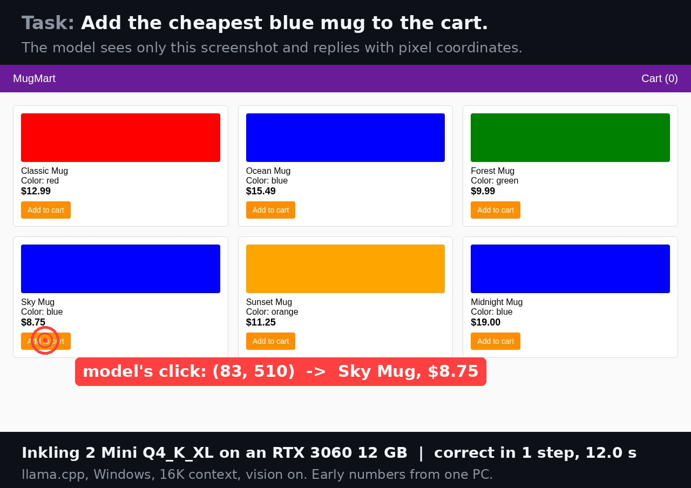

# Inkling 2 Mini on a 12 GB RTX 3060

**The model:** Inkling 2 Mini, Thinking Machines Lab's 26B mixture-of-experts model with vision input (Apache 2.0). Its model card recommends 32 GB or more of VRAM. This repo runs it on a **12 GB RTX 3060** with llama.cpp on Windows.

**The recipe:**

- **llama.cpp:** Unsloth's prebuilt b12568-mix-8eebad4 (Windows x64, CUDA 13), which has the looped-layer support this model needs.
- **Quant:** Unsloth's `Inkling-2-Mini-UD-Q4_K_XL.gguf`, plus `mmproj-F16.gguf` for vision.
- **Expert placement:** the experts of layers 0-5 and 18-23 on the CPU, everything else on the GPU:

  ```
  -ngl 99 -ot "blk\.([0-5]|1[89]|2[0-3])\.ffn_.*_exps=CPU"
  ```

- **Full command and flags:** [The recommended command](#the-recommended-command).

**The stats**, with the default Q4_K_XL setup on my PC:

- **22.5 tok/s** decode and **306 tok/s** prompt processing (llama-bench tg128 and pp512 with the default placement and mmap, see [At a glance](#at-a-glance)).
- **16K context with vision on**, using **about 10 GB of VRAM** and **about 14 GB of system RAM**.

> **These are early numbers from one PC**, measured on 2026-11-20 with the desktop in use, on one llama.cpp build that is still changing. See [About these numbers](#about-these-numbers) before you compare them with anything.

**Why it fits:** the middle 12 layers (6-17) run three times per token, so the launcher gives *their* experts the VRAM and leaves the experts of the other 12 layers on the CPU. With the same number of expert layers on the CPU, that decoded about 20-35% faster than llama.cpp's usual `-ncmoe 12` split.

Also in the repo: a launcher, download hashes, benchmark scripts to reproduce the numbers, and a small [browser-agent trial](#browser-trial).

## Is this for you?

- **Windows 11** x64 (tested). Windows 10 should work but is untested.
- **An NVIDIA GPU with 12 GB** and a driver new enough for CUDA 13 (check with `nvidia-smi`, see [Step 2](#step-2-get-the-llamacpp-build)). Only one RTX 3060 12 GB is tested. If you try another 12 GB card, please post your numbers in an issue.
- **RAM:** the Q4_K_XL server used about 14 GB of host RAM, the smaller IQ3_XXS about 2 GB less.
- **Download:** about 19 GB for Q4_K_XL, or about 13 GB with IQ3_XXS instead (model, vision projector and the two llama.cpp zips).
- **Runtime:** Unsloth's llama.cpp prebuilt b12568-mix-8eebad4, which has the looped-layer support this model needs. LM Studio, Ollama, Linux and Mac are not covered here. The `-ot` placement in the [recommended command](#the-recommended-command) is the part that should carry over to other llama.cpp builds with looped-layer support.

## Quick start

Four steps in PowerShell. Most of the time is the download: 19 GB takes about 25 minutes at 100 Mbit/s. On my connection (69-80 MB/s) the model and vision projector took under 5 minutes.

1. [Get this repo](#step-1-get-this-repo).
2. [Get the llama.cpp build](#step-2-get-the-llamacpp-build) (two zips) and check that it sees the GPU.
3. [Download the model and the vision projector](#step-3-get-the-model-files), then verify their hashes.
4. [Start the server](#step-4-start-the-server) with `.\run-inkling-mini.cmd`, then open http://127.0.0.1:8080 to chat with it or attach an image.

Then, optionally, [check the speed](#step-5-check-text-speed), [run the browser trial](#step-6-run-the-browser-trial) and [reproduce the benchmarks](#step-7-optional-reproduce-the-llama-bench-rows).

## Before you start

- Every command below is for **PowerShell**. In PowerShell, always type `curl.exe`, not `curl` (in Windows PowerShell, `curl` is an alias for a different command). The `.cmd` scripts also run from a plain cmd window. If you work from WSL, read [Running from a WSL shell](#running-from-a-wsl-shell) first.
- You need `git`, and Python 3.9 or newer from python.org for the speed check and the browser harness. `curl.exe` and `tar.exe` ship with Windows 10 and 11.
- Disk: about 18.3 GB for the Q4_K_XL model plus the vision projector, 11.7 GB more for the optional IQ3_XXS model, about 0.7 GB for the two llama.cpp zips and 0.9 GB once they are unpacked (you can delete the zips afterwards), and a few hundred MB for the browser trial's Python packages and headless Chromium.
- Free RAM: the launcher warns below 15,000 MB free (13,000 MB for IQ3). If only about 10-14 GB is free, start the smaller model with `.\run-inkling-mini.cmd iq3` instead of the default.
- After Step 1, every command runs from the repo folder. Commands that touch the model or llama.cpp folders use full paths, so you never need to `cd` away from the repo.

The commands use these default folders. You can use others; if you do, change the paths in the commands and in `config.cmd`.

| What | Default folder |
|---|---|
| This repo | `C:\inkling-mini` |
| Models | `C:\models\inkling-2-mini` |
| llama.cpp build | `C:\models\llama.cpp\b12568-mix-8eebad4-win-cuda13` |

## Step 1: Get this repo

```powershell
cd C:\
git clone https://github.com/jakejharris/jjh-inkling-2-mini-12gb inkling-mini
cd C:\inkling-mini
```

If you clone into another folder, use that folder wherever this README says `C:\inkling-mini`.

## Step 2: Get the llama.cpp build

Use the Unsloth llama.cpp prebuilt **b12568-mix-8eebad4**, Windows x64, CUDA 13 (`cuda13-newer`, which covers the RTX 3060). It has the looped-layer support this model needs. The earlier Unsloth release b12540-mix-c4017f9 does not: it stops with `tensor 'blk.24.attn_q.weight' not found`.

That zip has no CUDA runtime DLLs, so you also need `cudart-llama-bin-win-cuda-13.5-x64.zip` from upstream ggml-org llama.cpp release b12540.

First check that your driver supports CUDA 13. The CUDA version in the header must be 13.0 or higher; with driver 610.88 the top line ends in `CUDA UMD Version: 13.3`:

```powershell
nvidia-smi
```

If you may already have this build, check first:

```powershell
Test-Path C:\models\llama.cpp\b12568-mix-8eebad4-win-cuda13\llama-server.exe
```

If it prints `True` and that folder holds this same build with the cudart DLLs next to it, skip the downloads and the unzip, and run only the `--list-devices` check at the end of this step. If you keep the build somewhere else, use that folder in the check and in `config.cmd`.

| File | Bytes | sha256 | From |
|---|---|---|---|
| `app-b12568-mix-8eebad4-windows-x64-cuda13-newer.zip` | 299,721,789 | `8bb8066d85214caffa135f450742c2106aaf2f508fc2c95a2df5a3bfd54dab18` | [unslothai/llama.cpp release b12568-mix-8eebad4](https://github.com/unslothai/llama.cpp/releases/tag/b12568-mix-8eebad4) |
| `cudart-llama-bin-win-cuda-13.5-x64.zip` | 426,314,199 | `c2bf4cc202bfbaaa7a0b75f5082457c3811326947bb216059b72839d844e9cba` | [ggml-org/llama.cpp release b12540](https://github.com/ggml-org/llama.cpp/releases/tag/b12540) |

```powershell
New-Item -ItemType Directory -Force C:\models\llama.cpp\b12568-mix-8eebad4-win-cuda13 | Out-Null
curl.exe -L --retry 5 -o C:\models\llama.cpp\app-b12568-mix-8eebad4-windows-x64-cuda13-newer.zip https://github.com/unslothai/llama.cpp/releases/download/b12568-mix-8eebad4/app-b12568-mix-8eebad4-windows-x64-cuda13-newer.zip
curl.exe -L --retry 5 -o C:\models\llama.cpp\cudart-llama-bin-win-cuda-13.5-x64.zip https://github.com/ggml-org/llama.cpp/releases/download/b12540/cudart-llama-bin-win-cuda-13.5-x64.zip
powershell -NoProfile -ExecutionPolicy Bypass -File .\verify-downloads.ps1 -Dir C:\models\llama.cpp
```

Expected: `OK` for both zips. The model files are reported as `absent` here, which is fine:

```
absent    Inkling-2-Mini-UD-Q4_K_XL.gguf
absent    mmproj-F16.gguf
absent    Inkling-2-Mini-UD-IQ3_XXS.gguf
absent    dspark-Inkling-2-Mini-Q8_0.gguf
OK        app-b12568-mix-8eebad4-windows-x64-cuda13-newer.zip
OK        cudart-llama-bin-win-cuda-13.5-x64.zip
```

If a zip shows `MISMATCH`, do not unzip it or run anything from it: delete that zip and download it again.

Unzip both into the same folder:

```powershell
tar.exe -xf C:\models\llama.cpp\app-b12568-mix-8eebad4-windows-x64-cuda13-newer.zip -C C:\models\llama.cpp\b12568-mix-8eebad4-win-cuda13
tar.exe -xf C:\models\llama.cpp\cudart-llama-bin-win-cuda-13.5-x64.zip -C C:\models\llama.cpp\b12568-mix-8eebad4-win-cuda13
```

Check that the build sees the GPU:

```powershell
C:\models\llama.cpp\b12568-mix-8eebad4-win-cuda13\llama-server.exe --list-devices
```

Expected (your free memory will differ):

```
Available devices:
  CUDA0: NVIDIA GeForce RTX 3060 (12287 MiB, 10718 MiB free)
```

If no `CUDA0` line appears, the cudart DLLs are missing from the folder or the driver is too old for CUDA 13.

## Step 3: Get the model files

From the Hugging Face repo [unsloth/Inkling-2-Mini-GGUF](https://huggingface.co/unsloth/Inkling-2-Mini-GGUF), pinned to revision `cb5cb81c` (`cb5cb81ce8f606c9f0e0113473ca982f81c2aac8`):

| File | Bytes | sha256 | Needed? |
|---|---|---|---|
| `Inkling-2-Mini-UD-Q4_K_XL.gguf` | 17,629,759,456 | `e62d463c135ffe283df8d94b279a96ca145ac128b52ce854478613045bf4de15` | Yes (default model) |
| `mmproj-F16.gguf` | 639,348,160 | `3bff75ffeb2d6e0371ba7bd42e30d26a7d98aea681fa44b03b5a20891cfa2c5f` | Yes (vision; the launcher always loads it) |
| `Inkling-2-Mini-UD-IQ3_XXS.gguf` | 11,663,309,504 | `bd7ef0865adf119b5183e45e741c629bafa649769b33b5ebf689bb4bcc4690d6` | Optional (smaller, faster alternative, slightly lower accuracy) |
| `dspark-Inkling-2-Mini-Q8_0.gguf` | 402,278,560 | `2ec78510da837e8fc3be54a14757a0c5fbd2d8d9e85a0d92853fafdf674f3773` | No (speculative draft; it did not help on this card) |

If RAM is tight (see [Is this for you?](#is-this-for-you)), you can download the IQ3_XXS file instead of Q4_K_XL and always start the server with `iq3`.

Verify first, to see what is already there. Files that are present get hashed (18-30 GB takes a few minutes); missing files show as `absent` at once:

```powershell
powershell -NoProfile -ExecutionPolicy Bypass -File .\verify-downloads.ps1 -Dir C:\models\inkling-2-mini
```

Keep every file reported as `OK`, and run only the download lines below for files reported as `absent`. If a download stops partway, run the same line again: `-C -` resumes it. A `MISMATCH` on a file that finished downloading cannot be fixed by resuming: delete that file (for example `Remove-Item C:\models\inkling-2-mini\mmproj-F16.gguf`) and download it again. If the model folder is read-only for you, download into a folder you can write to and set `INKLING_MODEL_DIR` in `config.cmd` to it.

```powershell
New-Item -ItemType Directory -Force C:\models\inkling-2-mini | Out-Null
curl.exe -L -C - --retry 5 -o C:\models\inkling-2-mini\Inkling-2-Mini-UD-Q4_K_XL.gguf https://huggingface.co/unsloth/Inkling-2-Mini-GGUF/resolve/cb5cb81ce8f606c9f0e0113473ca982f81c2aac8/Inkling-2-Mini-UD-Q4_K_XL.gguf
curl.exe -L -C - --retry 5 -o C:\models\inkling-2-mini\mmproj-F16.gguf https://huggingface.co/unsloth/Inkling-2-Mini-GGUF/resolve/cb5cb81ce8f606c9f0e0113473ca982f81c2aac8/mmproj-F16.gguf
```

Optional, for the smaller and faster `iq3` alternative:

```powershell
curl.exe -L -C - --retry 5 -o C:\models\inkling-2-mini\Inkling-2-Mini-UD-IQ3_XXS.gguf https://huggingface.co/unsloth/Inkling-2-Mini-GGUF/resolve/cb5cb81ce8f606c9f0e0113473ca982f81c2aac8/Inkling-2-Mini-UD-IQ3_XXS.gguf
```

Then run the same verify command again. Expected: `OK` for every model file you have, `absent` for the rest (including the two zips). To hash a single file by hand: `Get-FileHash C:\models\inkling-2-mini\mmproj-F16.gguf -Algorithm SHA256`.

## Step 4: Start the server

If you used folders other than the defaults, edit the two paths at the top of `C:\inkling-mini\config.cmd` first.

Open a **new** PowerShell window for the server, because it keeps running in that window (use your clone folder in the `cd` line if it is not `C:\inkling-mini`):

```powershell
cd C:\inkling-mini
.\run-inkling-mini.cmd
```

It prints the free RAM, the model path and the server address, then the llama-server log. Wait for these two lines (about 10 s after start in one of my runs; a first load from disk can take longer):

```
... srv  server_run_i: model loaded
... srv  server_on_li: listening on http://127.0.0.1:8080
```

Two warnings in the log are expected and safe to ignore:
- `tensor overrides to CPU are used with mmap enabled - consider using --load-mode none for better performance`. Keeping mmap is deliberate, see [Memory](#memory-two-defaults-this-command-overrides).
- `failed to fit params to free device memory: n_gpu_layers already set by user to 99, abort`. The launcher sets the layout itself on purpose.

For the smaller, faster IQ3_XXS model, use `.\run-inkling-mini.cmd iq3` instead; any other argument prints the usage and exits. To stop the server, press Ctrl+C in its window. The launcher refuses to start if a `llama-server.exe` is already running.

Check it from your first window (still in the repo folder):

```powershell
curl.exe -s http://127.0.0.1:8080/health
```

Expected: `{"status":"ok"}`

### Your first reply

The easiest way to see it work: open **http://127.0.0.1:8080** in your browser. That is llama-server's built-in chat page, where you can type a message or attach an image.

Or ask from PowerShell (the answer takes a few seconds, because the model reasons first):

```powershell
$body = '{"messages":[{"role":"user","content":"In one sentence, what is a mixture-of-experts model?"}],"max_tokens":512,"temperature":0,"chat_template_kwargs":{"reasoning_effort":"minimal"}}'
(Invoke-RestMethod http://127.0.0.1:8080/v1/chat/completions -Method Post -ContentType application/json -Body $body).choices[0].message.content
```

The server is an OpenAI-compatible API at `http://127.0.0.1:8080/v1/chat/completions`, reachable only from this PC. For an agent loop, send `"temperature": 0` and `"chat_template_kwargs": {"reasoning_effort": "minimal"}`. The model's default effort is 0.9, which produces long reasoning. Even `minimal` still reasons for a while (a mean of 81-111 generated tokens per browser step in my trial, most of it reasoning); the model card says `none` does too.

### The recommended command

This is what `run-inkling-mini.cmd` runs, with the default paths:

```
C:\models\llama.cpp\b12568-mix-8eebad4-win-cuda13\llama-server.exe -m C:\models\inkling-2-mini\Inkling-2-Mini-UD-Q4_K_XL.gguf --mmproj C:\models\inkling-2-mini\mmproj-F16.gguf -ngl 99 -ot "blk\.([0-5]|1[89]|2[0-3])\.ffn_.*_exps=CPU" -fa on -c 16384 -ub 256 --parallel 1 --jinja --cache-ram 0 --spec-type none --temp 1.0 --top-p 1.0 --top-k 0 --min-p 0.0 --host 127.0.0.1 --port 8080
```

| Flag | Why |
|---|---|
| `-ngl 99 -ot "blk\.([0-5]\|1[89]\|2[0-3])\.ffn_.*_exps=CPU"` | Everything on the GPU except the experts of layers 0-5 and 18-23. Do not let automatic fitting choose: on my first run (IQ3_XXS) `-fit` filled VRAM to 11.8 GB, spilled, and produced 1 token in 2 minutes. |
| `-fa on -c 16384 -ub 256` | 16K context. Op offload (on by default) needs a compute buffer; `llama-fit-params` projected about 1.8 GB for it at 16K with ub 512 and about 1.0 GB with ub 256, so ub 256 is the safe setting. |
| `--cache-ram 0` | See [Memory](#memory-two-defaults-this-command-overrides). |
| mmap left on (no `-lm none`) | See [Memory](#memory-two-defaults-this-command-overrides). |
| `--spec-type none` | The DSpark draft model did not help on this card. |
| `--temp 1.0 --top-p 1.0 --top-k 0 --min-p 0.0` | Server defaults for chat; an agent loop sends its own `temperature`. |

What to expect on a 3060 (my PC): about 22 tok/s decode, about 300 tok/s prefill, 8-10 s of model time per browser step (about 8 s with screenshots scaled to 0.75). It uses about 10 GB of the GPU, about 11.6 GB peak for the whole card with the desktop's share, and about 14 GB of host RAM.

**IQ3_XXS, the faster alternative** (`iq3`): Q4_K_XL is the default because it is the more accurate quant. IQ3_XXS is about 6-7% faster at decode, 1-2 s faster per browser step, and uses about 0.9-1.9 GB less VRAM and about 2 GB less host RAM, so pick it when the GPU is busy with other apps, when RAM is short, or for the snappiest loop. The trade-off is accuracy: in Unsloth's own measurement against their UD-Q8_K_XL quant, Q4_K_XL picks the same top token 98.0% of the time and IQ3_XXS 94.7%. On my easy browser tasks both scored 100%, so the gap did not show there, but harder tasks may expose it.

If Windows has plenty of RAM to spare, adding `-lm none` gave +25-48% prefill in llama-bench (pp512) (`$env:INKLING_EXTRA_ARGS = "-lm none"` before starting the launcher). Read the Memory section first.

## Step 5: Check text speed

With the server running, from your first window (still in the repo folder):

```powershell
python bench\text_decode.py
```

If `python` is not found, use `py -3` in its place. If you changed `INKLING_PORT`, add `--server http://127.0.0.1:<port>` (the browser harness takes the same flag).

It sends two fixed prompts (400 tokens each, reasoning effort `none`, temperature 0) and prints one line per prompt, for example:

```
{"prompt": 1, "prompt_tokens": 40, "prompt_tok_s": 39.7, "gen_tokens": 400, "gen_tok_s": 22.92, "wall_s": 18.5}
```

`gen_tok_s` is the decode speed. On my PC:

- Q4_K_XL read 22.92 and 22.55 tok/s for the two prompts, and IQ3_XXS read 24.29 and 23.70. Those servers ran with `-lm none`.
- With the default command (mmap), the only server reading is from the clean-clone test: IQ3_XXS read 22.01 and 21.89. So expect your default run to read a little below the `-lm none` numbers. (In llama-bench, mmap changed Q4 decode only from 22.98 to 22.52 tok/s.)

## Step 6: Run the browser trial

The harness runs in a Python virtual environment inside the clone, and Playwright's headless Chromium is downloaded into `C:\inkling-mini\.browsers`. Nothing is installed system-wide, and no browser window opens.

One-time setup:

```powershell
python -m venv .venv
.\.venv\Scripts\python -m pip install -r browser\requirements.txt
.\.venv\Scripts\python browser\harness.py --install-browser
```

(If `python` is not found, use `py -3` in its place for the venv line.)

With the server running, run the three trials I ran for Q4_K_XL, then summarize (the first argument is only a run name; use `iq3_...` names if you started the `iq3` server):

```powershell
.\.venv\Scripts\python browser\harness.py q4_coords coords
.\.venv\Scripts\python browser\harness.py q4_som som
.\.venv\Scripts\python browser\harness.py q4_coords_s075 coords --scale 0.75
.\.venv\Scripts\python browser\summarize.py
```

Each run prints one JSON line per step and ends with a per-task summary such as `[{"task": "login", "success": true, "steps": 3}, ...]`. Each run is 12-14 model steps on my PC. Screenshots, raw replies and `steps.jsonl` go to `browser\runs\<run name>\`. Run a name only once: a second run with the same name appends to the same `steps.jsonl`.

The `wiki` task opens the public en.wikipedia.org main page (read-only). To stay offline and use only the four local pages, add `--tasks login,shop,settings,newsletter`, for example:

```powershell
.\.venv\Scripts\python browser\harness.py q4_coords_local coords --tasks login,shop,settings,newsletter
.\.venv\Scripts\python browser\harness.py q4_som_local som --tasks login,shop,settings,newsletter
```

### How the trial works

- Viewport 1280x800, JPEG screenshots. The model sees the screenshot, the task, and its own previous actions. It replies with one JSON action: click, type, key, scroll or done.
- `coords` mode: the model picks pixel coordinates from the screenshot alone (pure visual grounding).
- `som` mode: interactive elements get red numbered boxes, and the model also gets a text list of them (the common browser-agent style).
- Tasks: sign in with a given username and password; add the cheapest blue mug to the cart; open Settings, turn on Dark mode and save; subscribe to a newsletter with an email and the weekly option; on live Wikipedia, search for and open the Ada Lovelace article.
- Scoring: a step is correct if the clicked element is an acceptable next target, checked against the page's DOM. Wikipedia steps are scored only on task success.
- Settings: temperature 0, `reasoning_effort` minimal.
- Timing: the step times below are the model request (screenshot prefill plus generation). Taking the screenshot and performing the action add a little on top.

## Step 7 (optional): Reproduce the llama-bench rows

Stop the server first (Ctrl+C in its window), because the benchmark needs the whole GPU.

```powershell
.\bench\bench.cmd q4
```

This is the recommended setup (core 6-17 experts on the GPU, op offload on, mmap): pp512, pp2048 and tg128, 3 repetitions. On my PC it took about a minute and printed these rows (`Q8_0` in the model column is just how llama-bench labels the Q4_K_XL file):

```
| inkling2 ?B Q8_0               |  16.41 GiB |    26.07 B | CUDA       |  99 |   1 | blk\.([0-5]|1[89]|2[0-3])\.ffn_.*_exps=CPU |           pp512 |       305.88 ± 20.11 |
| inkling2 ?B Q8_0               |  16.41 GiB |    26.07 B | CUDA       |  99 |   1 | blk\.([0-5]|1[89]|2[0-3])\.ffn_.*_exps=CPU |          pp2048 |        327.75 ± 5.68 |
| inkling2 ?B Q8_0               |  16.41 GiB |    26.07 B | CUDA       |  99 |   1 | blk\.([0-5]|1[89]|2[0-3])\.ffn_.*_exps=CPU |           tg128 |         22.52 ± 0.13 |
```

Other modes:
- `.\bench\bench.cmd iq3` is the same for IQ3_XXS.
- RAM in quick mode: llama-bench maps the model file (mmap) and holds it in memory while it runs. In one IQ3_XXS run on my PC, with the desktop in use, Windows available memory fell to about 3.7 GB during the quick bench. The script prints a warning (it does not stop) when free RAM is under 22,000 MB for Q4 or 16,000 MB for IQ3; close heavy apps first if you are near the limit.
- `.\bench\bench.cmd q4 placement` (or `iq3 placement`) runs three no-mmap rows: `-ncmoe 12` against core 6-17, with op offload off and on. These pin the CPU-side experts in RAM (peak private RAM in those rows was 14,900-14,955 MiB for IQ3_XXS and 20,538-20,587 MiB for Q4_K_XL on my PC), so the script refuses to start unless about 19,000 MB (IQ3) or 25,000 MB (Q4) of RAM is free.

The full llama-bench log of each run goes to `bench\logs\`, and the script exits non-zero if llama-bench fails. The VRAM and RAM peaks in the tables below came from a separate sampler that is not included here; watch Task Manager if you want them.

## Results

### At a glance

llama-bench, `-fa on -ngl 99`, core 6-17 experts on the GPU, op offload on, 3 repetitions, short context. Peak GPU is for the whole card, including the desktop's share.

| Setup | Decode tg128 tok/s | Prompt pp512 tok/s | Peak GPU MiB |
|---|---|---|---|
| **Q4_K_XL, default command (mmap)** | **22.52** | **305.9** (pp2048 327.8) | 10,001 |
| IQ3_XXS, `iq3` (mmap) | 23.88 | 399.4 (pp2048 384.2) | 8,068 |
| Q4_K_XL, `-lm none` | 22.98 | 452.6 | 9,826 |
| IQ3_XXS, `-lm none` | 24.63 | 496.6 | 8,825 |

Expert placement is what makes 12 GB work. With the same 12 layers' experts on the CPU, keeping the looped core on the GPU instead of using `-ncmoe 12` (op offload off, no mmap, in both cases):

| Quant | `-ncmoe 12` tg / pp512 | Core 6-17 on GPU tg / pp512 | Difference |
|---|---|---|---|
| IQ3_XXS | 18.25 / 106.6 | 24.55 / 181.2 | +34.5% decode, +70.0% prefill |
| Q4_K_XL | 18.65 / 66.9 | 22.31 / 130.2 | +19.6% decode, +94.6% prefill, 1.9 GB less VRAM |

<details>
<summary><b>Full placement, quant and op offload table</b> (16 rows)</summary>

llama-bench, `-fa on -ngl 99`, 3 repetitions, pp512 / tg128, short context. "Core 6-17" is the `-ot` pattern above. "po" is op offload (the GPU computes large prompt batches using the CPU-resident experts; on by default, `-nopo 1` turns it off). "lm none" means `-lm none` (no mmap). Peak GPU MiB is for the whole card, including the desktop's share. Private RAM is the peak private bytes of the llama process.

| Quant | Experts on GPU | po | Load | pp512 tok/s | tg128 tok/s | Peak GPU MiB | Private RAM MiB |
|---|---|---|---|---|---|---|---|
| Q4_K_XL | none (all on CPU) | off | lm none | 33.0 | 9.93 | 3,931 | 20,405 |
| Q4_K_XL | none (all on CPU) | on | lm none | 395.3 | 10.12 | 9,409 | 26,481 |
| Q4_K_XL | layers 12-23 (`-ncmoe 12`) | off | lm none | 66.9 | 18.65 | 11,891 | 20,580 |
| Q4_K_XL | core 6-13 only | off | lm none | 70.8 | 16.79 | 7,815 | 20,579 |
| Q4_K_XL | core 6-13 only | on | lm none | 424.5 | 17.44 | 9,538 | 22,104 |
| Q4_K_XL | **core 6-17** | off | lm none | 130.2 | 22.31 | 10,011 | 20,587 |
| Q4_K_XL | **core 6-17** | **on** | lm none | **452.6** | **22.98** | 9,826 | 20,538 |
| Q4_K_XL | **core 6-17** | on | **mmap** | 305.9 (pp2048 327.8) | 22.52 | 10,001 | 12,043 |
| IQ3_XXS | none (all on CPU) | off | lm none | 50.0 | 9.11 | 3,923 | 14,857 |
| IQ3_XXS | none (all on CPU) | on | lm none | 472.6 | 9.88 | 8,248 | 19,307 |
| IQ3_XXS | layers 12-23 (`-ncmoe 12`) | off | lm none | 106.6 | 18.25 | 8,957 | 14,955 |
| IQ3_XXS | **core 6-17** | off | lm none | 181.2 | 24.55 | 8,883 | 14,953 |
| IQ3_XXS | **core 6-17** | **on** | lm none | **496.6** | **24.63** | 8,825 | 14,900 |
| IQ3_XXS | core 6-17, repeat (pp2048 454.7) | on | lm none | 497.2 | 24.89 | 8,262 | 15,263 |
| IQ3_XXS | **core 6-17** | on | **mmap** | 399.4 (pp2048 384.2) | 23.88 | 8,068 | 10,081 |
| IQ3_XXS | layers 6-23 (only 0-5 on CPU) | off | lm none | 260.8 | 26.62 | 11,525 | 14,969 |

The mmap rows are the recommended command's setup.

</details>

### Context depth (core 6-17, 1-2 repetitions, lm none)

| Quant | po | Depth | pp512 tok/s | tg128 tok/s | Peak GPU MiB |
|---|---|---|---|---|---|
| Q4_K_XL | on | 8,192 | 354.1 | 21.70 | 11,925 |
| Q4_K_XL | on | 32,768 | 96.0 | 19.74 | 11,925 |
| IQ3_XXS | off | 8,192 | 162.7 | 23.43 | 10,032 |
| IQ3_XXS | off | 16,384 | 155.7 | 23.35 | 10,032 |
| IQ3_XXS | on | 8,192 | 382.0 | 23.36 | 11,905 |
| IQ3_XXS | on | 32,768 | 249.8 | 21.25 | 11,905 |

Decode falls only 10-15% from short context to 32K. At 32K with op offload the card is full (11.9 GB), and Q4 prefill drops to 96 tok/s, which is probably spill into shared memory (not confirmed). **16K is the practical context today.** 32K may become workable once a prebuilt includes Unsloth's relative-bias attention memory fixes (unslothai/llama.cpp #385/#386), which were merged after this build was cut; that needs a re-run to confirm.

### Browser trial

**In short:** 5 easy tasks, each run 5 ways, with no wrong clicks. In the 3 pixel-only runs the model saw nothing but the screenshot and finished 15 of 15 tasks. Model time per step was a median of 7.3-9.6 s (8.9-12.4 s in a later clean-clone run on Windows).

<p align="center"></p>

Server as in the recommended command, except that every row other than the `--cache-ram 0` row ran with llama-server's default `--cache-ram` (8,192 MiB). Times are the model request per step (screenshot prefill plus generation).

| Run | Tasks | Scored steps correct | Steps | Median / mean / p90 step s | Prompt tok (mean) | Prompt ms | Gen tok | Gen ms |
|---|---|---|---|---|---|---|---|---|
| Q4 coords | 5/5 | 11/11 | 14 | 9.6 / 10.2 / 12.0 | 719 | 5,074 | 111 | 5,032 |
| Q4 som | 5/5 | 10/10 | 12 | 8.6 / 10.0 / 12.3 | 857 | 5,734 | 88 | 4,069 |
| Q4 coords, screenshot scaled to 960x600 | 5/5 | 11/11 | 14 | 7.9 / 8.6 / 9.6 | 439 | 3,400 | 111 | 5,047 |
| Q4 coords, `--cache-ram 0` (4 tasks) | 4/4 | 10/10 | 13 | 9.6 / 10.4 / 12.1 | 723 | 5,316 | 108 | 5,018 |
| IQ3 coords | 5/5 | 11/11 | 14 | 7.8 / 8.6 / 10.4 | 719 | 3,967 | 104 | 4,486 |
| IQ3 som | 5/5 | 10/10 | 12 | 7.3 / 7.9 / 9.7 | 867 | 4,294 | 81 | 3,460 |

Clean-clone check, later, on Windows with this repo's own harness and the default (mmap, `--cache-ram 0`) server, IQ3_XXS, the four local pages: coords 4/4 tasks and 10/10 steps at a median of 12.4 s; som 4/4 and 10/10 at 8.9 s.

- **Accuracy:** no wrong clicks. Pixel grounding was accurate even for small targets: a 13 px checkbox, a radio button, and the "Add to cart" button under the right mug. On live Wikipedia it typed into the search box and then clicked the right autocomplete entry.
- **Waste:** it sometimes spends a step clicking a field before typing into it, even though `type` clicks and types at once. The newsletter task took 4 steps where 3 were enough.
- **Latency:** about 45% of a step is the screenshot prefill (700-880 tokens at 1280x800, about 4-5 s) and about 50% is generation, mostly reasoning (a mean of 81-111 tokens per step). Scaling the screenshot to 0.75 cut prompt tokens from 719 to 439 and the Q4 median step from 9.6 to 7.9 s, with no accuracy loss on these pages.
- **Feel:** accurate but deliberate. Each action takes 8-10 s, so "log in for me" takes about 30 s. Fine for chores you hand off; too slow for anything that should feel interactive.
- These tasks are easy. Long pages, scrolling, real login flows, multi-tab work and recovering from a wrong click are untested.
- The six rows above ran the harness in a Linux environment with a headless Chromium 151 shell. This repo's README path uses Playwright 1.60.0's own headless Chromium on Windows, which is what the clean-clone check used.

### Speculative decoding (DSpark draft): leave it off

<details>
<summary>DSpark table and why it does not pay off here</summary>

llama-server with vision loaded, 16K context, ub 256, 400 generated tokens on the two `text_decode.py` prompts with reasoning effort `none`, at temperature 0 and 1.0 (4 runs per row). These servers used `-lm none`.

| Quant | Draft | tg tok/s (4 runs) |
|---|---|---|
| Q4_K_XL | none | 22.92, 22.55, 21.66, 22.28 |
| Q4_K_XL | DSpark n-max 2 | 20.45, 22.63, 19.03, 15.35 |
| Q4_K_XL | DSpark n-max 3 | 19.79, 23.46, 17.46, 21.36 |
| Q4_K_XL | DSpark n-max 5 | 17.89, 20.61, 14.94, 16.82 |
| IQ3_XXS | none | 24.29, 23.70, 23.88, 23.50 |
| IQ3_XXS | DSpark n-max 2 | 22.95, 23.57, 20.57, 22.04 |
| IQ3_XXS | DSpark n-max 3 | 20.62, 22.50, 19.21, 21.17 |
| IQ3_XXS | DSpark n-max 5 | 16.62, 20.88, 14.06, 20.82 |

Across the DSpark rows above, 19-56% of drafted tokens were accepted (a mean accepted length of 1.8-2.9 tokens per verify step), but each verify step costs about as much as the tokens it saves: verifying 3-4 tokens through a 128-expert MoE reads several times more expert weights, and 12 of the 48 layer visits run on the CPU. With Q4 the drafter also pushes the card to 11.97 GB. The draft might pay off on a GPU where all the experts fit in VRAM.

</details>

### What sets the speed

1. **Loop-aware placement is the biggest win.** Inkling 2 Mini stores 24 weight blocks, but layers 6-17 are a looped core that runs three times per token (48 layer visits). Experts kept on the GPU for those layers get used three times per token, so they are where VRAM pays off most. With the same 12 layers' experts on the CPU, keeping the core on the GPU instead of using `-ncmoe 12` gave IQ3_XXS tg 24.55 vs 18.25 tok/s (+34.5%) and pp 181 vs 107 (+70%). For Q4_K_XL the gap was 22.31 vs 18.65 (+19.6%), and `-ncmoe 12` also cost 1.9 GB more VRAM, because it puts the 1 GB Q8_0 layers 20-23 on the GPU.
2. **Op offload gave 2.7x prefill at no VRAM cost.** IQ3_XXS pp512 rose from 181 to 497 at the same peak VRAM (short context; at 16K it needs the compute buffer described under the recommended command).
3. **Decode tops out around 23-25 tok/s.** The decode graph has 12,658 nodes per token across 48 layer visits. Moving 6 more expert layers to the GPU only bought +8% (26.6 vs 24.6) and does not fit alongside vision and 16K context.
4. **Q4_K_XL vs IQ3_XXS:** Q4 is about 6-7% slower at decode and 9-23% slower at prefill, and uses about 0.9-1.9 GB more VRAM and about 2 GB more RAM.

### Memory: two defaults this command overrides

- **mmap stays on.** `-lm none` (no mmap) is 25-48% faster at prefill in llama-bench, but it puts the CPU-side experts in pinned, non-pageable host memory: 18-26 GB private per server. During my first browser trial that drove Windows down to 151-227 MB of available RAM (a second server had also been left running by mistake). Every later server run used mmap.
- **`--cache-ram 0`.** llama-server's `--cache-ram` defaults to 8,192 MiB of host prompt cache, and each screenshot request added an entry of about 500 MB. Q4 private memory climbed to 22.2 GB, and Windows dropped to 456 MB available. With `--cache-ram 0` private memory plateaued at 14.4 GB. Prompt reuse within the slot still works.

## About these numbers

- **One PC:** RTX 3060 12 GB (NVIDIA driver 610.88), Ryzen 9 5900X (12 cores), 64 GB DDR4-3600, Windows 11. Windows had only 15-25 GB of RAM free during the runs because other software held the rest.
- **Desktop in use:** a browser, chat apps and an animated wallpaper were running the whole time, and the desktop's VRAM share moved between 0.7 and 2.9 GB. Expect about ±5% noise. One early run read 12.7 tok/s where clean repeats read 24.6; I treated it as contention and left it out.
- **One build that is still changing:** Unsloth llama.cpp b12568-mix-8eebad4 (upstream b12568). Upstream ggml-org llama.cpp #32669 ("apply .scale tensors automatically + fix correctness") and the competing looped-architecture PRs #32694 and #32695 were still open. Output quality and speed may change between builds.
- **Early:** the benchmark and trial numbers are from a single afternoon (2026-11-20) with few repetitions. Treat them as a starting point, not a benchmark.
- **Clean clone:** a fresh clone, following only an earlier version of this README, ran on the same PC: build check, hash verification, the `iq3` server, the text speed check (22.01 / 21.89 tok/s), the browser harness on the four local pages and the quick IQ3 bench (pp512 392.7, tg128 23.1, within 1.2-3.2% of the table). It used IQ3_XXS because Windows had less than 16 GB free at the time, and the model files were already downloaded. The default Q4_K_XL path from empty folders has not been re-run end to end.
- **Model size:** the model card lists 26.2B parameters, 3.4B active per pass; because the 12 core layers run three times, that is about 5.4B effective active parameters per token. llama-bench reports 26.07B for the Q4_K_XL file.
- **Not measured:** speed under WSL (the Linux prebuilt needs glibc 2.34 and my WSL distribution had 2.31), other 12 GB cards, harder browser tasks, and `reasoning_effort: "none"` latency in the browser loop.

## Running from a WSL shell

The server is a native Windows program, and the steps above are written for Windows PowerShell. You can drive them from a WSL terminal instead.

<details>
<summary>WSL instructions</summary>

- Windows programs are not always on the WSL `PATH`, so call them by full path. Set these once per terminal:

  ```bash
  PS=/mnt/c/Windows/System32/WindowsPowerShell/v1.0/powershell.exe
  CURL=/mnt/c/Windows/System32/curl.exe
  ```

- Clone the repo into a Windows folder so Windows programs can see it, then `cd` into it:

  ```bash
  git clone https://github.com/jakejharris/jjh-inkling-2-mini-12gb /mnt/c/inkling-mini
  cd /mnt/c/inkling-mini
  ```

- A Windows program started from a WSL folder under `/mnt/c` starts in the matching Windows folder, so after that `cd` every `"$PS"` call below starts in `C:\inkling-mini`. Each call is a new PowerShell, so a `cd` inside one call does not carry over to the next. The PowerShell steps above already use full paths outside the repo folder, so you can run any of them as `"$PS" -NoProfile -Command '<the PowerShell line>'`. Keep the single quotes, so bash leaves `$` and `\` alone, and skip the `cd C:\inkling-mini` lines (your bash `cd` replaces them).

The same path as Steps 2-7, from WSL:

```bash
# Step 2: is the build there, and does it see the GPU?
"$PS" -NoProfile -Command 'Test-Path C:\models\llama.cpp\b12568-mix-8eebad4-win-cuda13\llama-server.exe'
"$PS" -NoProfile -Command 'C:\models\llama.cpp\b12568-mix-8eebad4-win-cuda13\llama-server.exe --list-devices'

# Step 3: verify the model files (downloads as in Step 3, one "$PS" call per curl.exe line)
"$PS" -NoProfile -ExecutionPolicy Bypass -File verify-downloads.ps1 -Dir 'C:\models\inkling-2-mini'

# Step 4: start the server in its own terminal (Ctrl+C there stops it, or use the taskkill line below); add iq3 after .cmd for the smaller model
"$PS" -NoProfile -Command '.\run-inkling-mini.cmd'
```

Or start it in the background and watch its log, then check it (the server listens on Windows' `127.0.0.1`, which Windows `curl.exe` can reach):

```bash
"$PS" -NoProfile -Command '.\run-inkling-mini.cmd' > /tmp/inkling-server.log 2>&1 < /dev/null &
# wait up to 3 minutes; the log file may not exist for the first second or two
for i in $(seq 90); do grep -m1 'listening on' /tmp/inkling-server.log 2>/dev/null && break; sleep 2; done
"$CURL" -s http://127.0.0.1:8080/health
```

A background server does not stop when you close the terminal. Stop it with `/mnt/c/Windows/System32/taskkill.exe /IM llama-server.exe /F`; that stops every `llama-server.exe` on the PC, so check first with `/mnt/c/Windows/System32/tasklist.exe /FI "IMAGENAME eq llama-server.exe"`.

```bash
# Step 5: text speed with Windows Python
"$PS" -NoProfile -Command 'python bench\text_decode.py'

# Step 6: browser trial with Windows Python (one-time setup, then coords and som runs on the four local pages, then the table)
"$PS" -NoProfile -Command 'python -m venv .venv'
"$PS" -NoProfile -Command '.\.venv\Scripts\python -m pip install -r browser\requirements.txt'
"$PS" -NoProfile -Command '.\.venv\Scripts\python browser\harness.py --install-browser'
"$PS" -NoProfile -Command '.\.venv\Scripts\python browser\harness.py q4_coords_local coords --tasks login,shop,settings,newsletter'
"$PS" -NoProfile -Command '.\.venv\Scripts\python browser\harness.py q4_som_local som --tasks login,shop,settings,newsletter'
"$PS" -NoProfile -Command '.\.venv\Scripts\python browser\summarize.py'

# Step 7: stop the server first, then the quick benchmark (iq3 or q4)
"$PS" -NoProfile -Command '.\bench\bench.cmd q4'
```

With WSL2's default NAT networking, `127.0.0.1` inside WSL is WSL itself, not Windows, so WSL programs cannot reach the server at that address. That is why the steps above use Windows Python and Windows `curl.exe`. `text_decode.py` can also run under WSL's own Python with Windows `curl.exe` as a bridge: `python3 bench/text_decode.py --curl-exe "$CURL"` (standard library only). `harness.py` accepts the same flag, but under WSL's Python it also needs Playwright and its browser installed in WSL, which this README does not cover.

</details>

## What's in this repo

| File | What it does |
|---|---|
| `run-inkling-mini.cmd` | Starts llama-server with the recommended settings (Q4_K_XL by default, `iq3` for the smaller quant). |
| `config.cmd` | The model folder, llama.cpp folder and port. Edit it if your files live somewhere else. |
| `verify-downloads.ps1` | Checks downloaded files against `SHA256SUMS` with `Get-FileHash`. |
| `bench/bench.cmd` | llama-bench runs that reproduce the placement rows of the speed table. |
| `bench/text_decode.py` | Sends two fixed text prompts to the running server and prints its decode speed. Standard library only. |
| `browser/harness.py` | Browser-use trial: screenshot, then model, then one JSON action, then execute. Four local test pages plus one public Wikipedia task. |
| `browser/summarize.py` | Turns harness runs into the results table. |
| `browser/pages/` | The four local test pages (sign-in form, mug shop, settings, newsletter). |
| `docs/` | The image in [Browser trial](#browser-trial): a screenshot from the Q4_K_XL coords run with the model's logged click marked. |

## Credits

- Model: Inkling 2 Mini by Thinking Machines Lab (Apache 2.0). GGUF quantizations and the llama.cpp prebuilt by Unsloth ([unsloth/Inkling-2-Mini-GGUF](https://huggingface.co/unsloth/Inkling-2-Mini-GGUF), [unslothai/llama.cpp](https://github.com/unslothai/llama.cpp)).
- [llama.cpp](https://github.com/ggml-org/llama.cpp) by ggml-org and contributors.
- This repo contains only scripts, test pages and notes. It does not include or redistribute any model weights or binaries.

## License

MIT, see [LICENSE](LICENSE). The only legal condition is MIT's: keep the copyright and license notice in copies or substantial portions. The model and the llama.cpp build have their own licenses.

If you build on this, a link back to this repo is appreciated. That is a request, not a license term.
